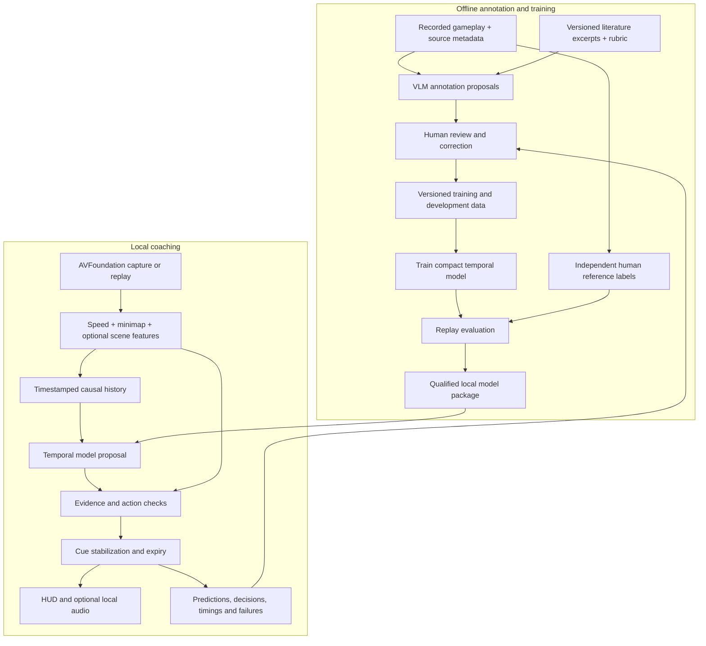

# Racing Trainer: Guidance Model Implementation Plan

Version 1.0 | 29 September 2026 | Status: proposed implementation specification

**Implementation update — 1 October 2026:** At Sean's request, a separate
[train-first perception bootstrap](../Training/guidance/bootstrap/README.md) now
has trained weights and offline replay tooling using provisional assistant labels.
Human testing on other footage follows training. This experimental exception to
the review-before-training plan below is not completion of the original audited
pilot, a validated action model, or live app integration. Keep its results and
unreviewed labels separate from independently reviewed datasets.

**Objective:** Build a local, real-time coach for The Crew Motorfest on PS4 Pro using gameplay video. Use a pre-trained vision-language model (VLM) and racing literature to propose offline annotations, review those annotations, train a smaller temporal model, and validate its coaching before enabling it during play.

This document specifies work to implement. It does not claim that a guidance model has been trained, that generated labels are correct, or that live coaching has passed evaluation. Source inspection below uses repository commit `185f33d`; no build, training run, or gameplay test was performed while writing this document.

## 1. Decisions and boundaries

| Area | Implementation decision |
| --- | --- |
| Product | Native macOS companion on the current M4 MacBook Air; visual guidance first, optional local audio afterward. |
| Input | PS4 Pro capture-card video or a saved recording through the existing AVFoundation pipeline. No required game telemetry or controller input. |
| Knowledge | Racing literature supplies annotation context and a review rubric. Its benefit must be measured. |
| Offline teacher | A pre-trained VLM proposes timestamped observations and coaching suggestions. Suggestions remain untrusted until reviewed. |
| Live learner | A small causal temporal model uses recent video-derived information to propose guidance. It runs locally. |
| Authority | Deterministic evidence checks can suppress any model recommendation. The model cannot override them. |
| Evaluation | Human reference labels, recording-separated datasets, event-level replay tests, and live shadow testing. |
| Improvement | Capture failures, diagnose their cause, correct data or code, rerun regressions, and qualify a new version. No automatic retraining during play. |

Start with default-HUD, uncropped 16:9 recordings and a documented set of cars, setups, camera views, and routes. Expand that set only after collecting and evaluating additional data. Record unsupported conditions explicitly.

The intended guidance includes corner direction and phase, brake/lift/maintain/conditional acceleration, and cue timing. Enable each output only after it has sufficient reviewed examples and passes its own gate. Target speed is optional until a defensible reference exists. Categorical turn guidance comes first; exact wheel angles, pedal percentages, autonomous control, traffic clearance, and definitive understeer diagnoses are outside the first milestone.

## 2. Current foundation and missing pieces

These are source-level findings, not new runtime verification.

| Component | Present in the repository | Work needed |
| --- | --- | --- |
| Capture and analysis | [FrameAnalyzer.swift](../Racing%20Trainer/FrameAnalyzer.swift) accepts frames, schedules work, and tracks source generations. | Add shared frame identities, synchronized feature export, complete timing instrumentation, and temporal inputs. |
| Speed recognition | [MotorfestSpeedRecognizer.swift](../Racing%20Trainer/MotorfestSpeedRecognizer.swift) uses Apple Vision and rejects candidates touching the crop edge. | Measure accepted errors, missing results, units, and latency; change the recognizer only when evidence justifies it. |
| Route perception | [MinimapDrivingCoachEngine.swift](../Racing%20Trainer/MinimapDrivingCoachEngine.swift) combines route geometry, tracking, and current guidance. | Export observations separately from coaching decisions. Keep geometry confidence distinct from coaching confidence. |
| Current coaching | [CoachSafetyPolicy.swift](../Racing%20Trainer/CoachSafetyPolicy.swift) checks evidence and chooses actions using hand-written thresholds. | Preserve this baseline and extract a reusable guard for learned proposals. The current function does not accept model proposals. |
| Replay tools | [CornerReplayModels.swift](../Racing%20Trainer/CornerReplayModels.swift) and [ReplayVideoSampler.swift](../Racing%20Trainer/ReplayVideoSampler.swift) support reviewed speed samples and approximate landmark alignment. | Extend review/export capabilities and build full pipeline replay with event labels. |
| Existing training | `Training/` contains route segmenter and component-verifier scripts and weights. | Create a separate guidance dataset and training workflow; route masks are not coaching labels. |
| Safety tests | `RacingTrainerSafetyTests/` contains policy and corner replay tests. | Add causal replay, integration, model parity, and cue-delivery checks as the corresponding features are implemented. |

The existing replay comparison describes speed differences between recordings. It explicitly does not establish optimal speed or authorize braking/acceleration. Reuse its provenance and review concepts, not its speed difference as a coaching answer.

The [older implementation status](IMPLEMENTATION_STATUS.md) and parent roadmap contain historical snapshots. Where they differ from current source, use current source for implementation status and new measured reports for performance claims.

## 3. Architecture



The VLM is absent from the live inference loop. Racing text is not streamed into the live coach. This is teacher-assisted supervised learning; training from reviewed hard labels does not require implementing formal knowledge distillation.

Python handles offline datasets, teacher experiments, training, and evaluation reports. Swift/AVFoundation/Vision remain the product implementation. Core ML is the intended deployment path, subject to an early conversion and performance test on the target Mac.

## 4. What the model must learn

Separate observations from recommendations so errors can be traced to the correct layer.

| Label family | Examples | Required evidence |
| --- | --- | --- |
| Observable state | HUD speed and unit, route direction, route visibility, corner phase | Visible pixels and timestamps. Record `unknown` when unreadable or ambiguous. |
| Coaching recommendation | Brake, lift, maintain, conditional acceleration; acceptable cue interval | Human-reviewed reasoning supported by the available state, game-specific examples, and coaching rubric. |
| Optional target speed | A range appropriate to a documented vehicle/setup and corner | Reviewed reference runs or a separately validated estimator. A VLM-generated number alone is insufficient. |
| Reliability | Missing evidence, ambiguity, unsupported setup, abstention | Explicit reasons and provenance; numeric teacher confidence is not proof of correctness. |

Do not label observed driver braking or throttle position as fact when controls are not visible. A speed decrease can have several causes. Likewise, finishing a corner successfully does not prove that every earlier action was optimal, and a later crash does not prove that an earlier cue caused it.

Use separate meanings for:

- `maintain`: an affirmative recommendation supported by reviewed evidence.
- `no_cue`: no intervention is warranted at this moment.
- `abstain`: the system lacks sufficient evidence to advise.

The existing `.hold` can represent a missing-speed fallback. Before introducing learned actions, separate that fallback from affirmative maintain guidance throughout the internal contract and presentation. Missing-speed fallback must not speak “maintain speed.”

Turn direction is also separate from steering input: “left bend ahead” does not establish how many degrees the player should turn the wheel.

## 5. Data collection and contracts

### 5.1 Recording manifest

Register original recordings before extracting clips. Each manifest includes:

- `recording_id`, `source_group_id`, original filename, SHA-256, duration, frame dimensions, and source frame timestamps.
- Route/event, car/setup, camera view, HUD profile, HUD speed unit, weather/lighting, capture device, and game version when known.
- `unknown` for unavailable metadata; no guessed values.
- Provenance/permission for using the footage, split assignment, and preprocessing version.

All derivatives of one recording or session keep the same source group. Alternate encodes, overlapping clips, and duplicate uploads must not cross splits. Search for duplicate/near-duplicate footage when registering new sources.

Video remains the sensor input. Manually supplied setup and HUD-unit metadata is configuration, and must also be available at deployment if a trained model depends on it.

### 5.2 Collection coverage

Collect complete approaches, corners, and exits, plus ordinary straight driving. Include left/right bends, different severities, appropriate and excessive approach speeds, mistakes, recovery, missing waypoint, hidden/cropped HUD, menus, capture stalls, and unsupported views. Preserve natural class frequency in an evaluation set; keep a separate deliberately difficult challenge set.

Begin with **100–300 reviewed event clips** to test the labeling workflow. This is a pilot size, not evidence that there is enough data for reliable coaching. Expand according to class coverage, disagreement, failure rates, and uncertainty in the evaluation results.

### 5.3 Causal time windows

For a decision at source time `t`, the deployed model can use only information from times at or before `t`. Start experiments with a two-second history sampled at 10 Hz. These are tunable development settings, not fixed requirements.

Store actual presentation timestamps, sampling gaps, missing-value masks, and observation ages. Do not silently duplicate a frame to disguise a capture gap. Reset history at source changes, seeks, restarts, and discontinuities; withhold guidance until the required valid history is available.

Reviewers can inspect a longer clip to understand an event, but must mark when the evidence first became available. Keep future outcomes separate from the information justifying a cue. Reject examples whose recommendation depends on something visible only after the decision time. Do not use centered smoothing or future-frame interpolation to construct live-model inputs.

### 5.4 Annotation record

Use a versioned JSONL schema. The following is an illustrative draft record, not a real labeled event. Its abstention is intentional: visible speed and direction alone do not establish the correct braking action.

```json
{
  "schema_version": 1,
  "recording_id": "session_001",
  "source_group_id": "session_001",
  "event_id": "corner_007",
  "decision_time_s": 42.0,
  "input_interval_s": [40.0, 42.0],
  "observations": {
    "hud_speed_displayed": 142,
    "hud_unit": "kmh",
    "speed_kph": 142.0,
    "turn_direction": "left",
    "corner_severity": "medium",
    "corner_phase": "approach"
  },
  "recommendation": {
    "acceptable_actions": ["abstain"],
    "cue_interval_s": null,
    "target_speed_range_kph": null,
    "reason": "Action timing and target speed are not established."
  },
  "evidence": {
    "latest_source_time_s": 42.0,
    "status": "partial",
    "literature_reference_ids": []
  },
  "annotation": {
    "origin": "teacher_proposal",
    "teacher_version": "candidate_A",
    "prompt_version": "v1",
    "literature_version": "v1",
    "review_status": "pending",
    "reviewer_id": null
  }
}
```

For a reviewed action event, `acceptable_actions` can contain multiple defensible choices, and `cue_interval_s` identifies the acceptable delivery window on the source timeline. Do not force a single exact frame or action when expert review cannot justify one.

The validator must reject invalid timestamps, inconsistent units, out-of-range values, unknown enum values, missing provenance, cross-split source groups, and input windows ending after the decision time. Preserve original proposals alongside corrections and review history.

## 6. Literature, teacher, and human review

### 6.1 Build the reference pack

Create short, cited concept summaries for approach, braking, turn-in, apex, exit, and uncertainty. For every principle, record its source, applicable conditions, video evidence needed, and limitations when transferred to Motorfest. Real-world racing principles do not directly supply game-specific speed thresholds.

**Research update, 30 September 2026:** a [curated literature report](RACING_LITERATURE_RESEARCH.md), [source catalog](../Training/guidance/literature/source_catalog.json), and [12 draft concept cards](../Training/guidance/literature/concept_cards.jsonl) are now available. The pack contains concise original paraphrases and explicitly separate project safeguards. Free material was reviewed; paid-book candidates were assessed from public descriptions only. The pack still requires expert review and the teacher comparison below; it has not been validated on Motorfest.

Store reference identifiers and versions with annotations. Do not fine-tune a language model on books as the first implementation step.

### 6.2 Run the teacher experiment

The [free-reference annotation pilot pack](../Training/guidance/teacher/README.md) provides draft instructions and proposed settings for an initial **perception-only** comparison. Its action field is deliberately forced to abstain and must not be used as action-training data. This preliminary output format is separate from the illustrative reviewed-action record in section 5.4. The runner, formal schema and validator still need implementation before batch use.

1. Select a development pilot with independent human reference labels.
2. Give the same teacher the same causal clips and output schema under two conditions: without literature, and with the reference pack.
3. Keep model version, frame sampling, instructions, and generation settings constant. Measure run-to-run variation on a subset.
4. Compare errors by field, unsupported assertions, abstention, and human correction time. Reviewers should not know which condition produced a proposal.
5. Keep literature context only where it improves measured quality or review efficiency without increasing serious errors. Record mixed results explicitly.

The prompt must ask for visible evidence, uncertainty, and structured output; it must prohibit inventing unreadable speed, controls, target speed, or exact steering. Proposed actions go into a separate field from observed state.

VLM hallucination is a documented risk; the POPE study concerns object hallucinations and does not validate racing guidance. Our independent label review is a project design response to that risk. [Primary research](https://arxiv.org/abs/2305.10355).

### 6.3 Review policy

Use three statuses: `pending`, `reviewed`, and `rejected`. Treat unreviewed proposals as weak labels and exclude them from the first supervised training run.

Review every pilot label used for training. Independently double-label at least 20% of the pilot, plus all action disagreements and serious-error cases. Record disagreements before adjudication. For the locked evaluation set, have reviewers produce reference labels without seeing teacher or student answers, then adjudicate coaching judgments with a reviewer experienced in the game/driving task.

If qualified reviewers cannot justify an action, keep its recommendation unknown. Perception training can continue using its reliable observation labels. Lack of trustworthy action labels blocks deployment of that action head; a second model agreeing with the first does not remove this blocker.

**Teacher exit gate:** a per-field audit report demonstrates which labels are usable, how much correction they need, and whether literature helps. If the teacher does not save effort or meet quality requirements, collect those labels manually. The system must remain buildable without automatic annotation.

Default to local annotation processing to preserve the existing local-data boundary. An external teacher API is a separate configuration choice requiring an agreed upload scope, cost limit, and data-handling policy before footage is sent. This document does not authorize uploads.

## 7. Dataset separation and training

### 7.1 Freeze the split

Target approximately 60% training, 20% development, and 20% locked test by source group, adjusted to keep supported classes represented. Independence and coverage take priority over the exact percentages. Hold out complete routes or vehicle setups separately when testing claims about unseen routes or cars.

Grouped evaluation prevents related examples from appearing on both sides of a train/evaluation split; apply that principle here at recording/session level. [scikit-learn grouped validation documentation](https://scikit-learn.org/stable/modules/cross_validation.html#cross-validation-iterators-for-grouped-data).

Use development data for prompt changes, normalization, architecture selection, decision thresholds, timing tolerances, and confidence calibration. Fit normalizers on training data only. Freeze the complete pipeline and acceptance policy before accessing locked test results. If test failures influence the next model, retain that test version for regression and establish a fresh unseen test set for the next independent claim.

### 7.2 Compare progressively more capable models

| Candidate | Inputs and role | Advancement condition |
| --- | --- | --- |
| A: existing policy | Current speed and route observations with existing thresholds. | Measured reference baseline; never treated as ground truth. |
| B: compact temporal feature model | Recent speed, route geometry, confidences, ages, masks, and time deltas through a small causal temporal convolutional network. | Demonstrates useful improvement over A on supported events. |
| C: temporal visual model | B plus compact embeddings of recent scene/minimap crops. | Adds a measured benefit that justifies annotation, compute, and deployment cost. |

Use a fixed-size sliding window initially to simplify export and state reset. Start with direction/phase and supported action classification. Add target-speed regression only when reviewed ranges exist; never fill missing speed targets with VLM guesses.

Use masked losses for missing labels, per-class metrics, and development-set threshold selection. Treat abstention as a first-class output. Teacher confidence must not become student confidence by copying a number. Measure whether the student's confidence corresponds to error rate on held-out development data.

Train with the same video-derived features that will be available live. Manually corrected labels are targets; they must not silently replace noisy OCR in the input. Measure both component quality and end-to-end quality with real perception errors.

Record the dataset hash, source split, training code commit, model/config versions, random seeds, preprocessing, losses, and all evaluation reports. Use at least three training seeds for the shortlisted configuration to expose unstable results. Select models using development results only.

### 7.3 Deployment feasibility before long training runs

Export a small untrained version of the chosen architecture to Core ML early. Check supported operations, shapes, memory, and timing on the target Mac. Apple documents PyTorch-to-Core-ML conversion and `.mlpackage` output; actual conversion and performance of this model remain to be tested. [Core ML conversion guide](https://apple.github.io/coremltools/docs-guides/source/convert-to-ml-program.html).

After training, compare Python and Swift outputs on fixed inputs, including missing data and boundary cases. Freeze numerical tolerances and permitted decision differences before qualification. Re-evaluate after quantization or any preprocessing change.

## 8. Validation: what counts as correct

Build the evaluator before training the first guidance model. Evaluate actual delivered cues after guards, stabilization, and any audio scheduling, as well as raw model outputs.

| Area | Measurement | Example failure |
| --- | --- | --- |
| HUD speed | Exact displayed-value accuracy, numeric error, accepted coverage, wrong unit rate | A clipped `114` accepted as `14`. |
| Direction and phase | Per-class precision/recall and confusion matrix | A right bend labeled left; exit labeled approach. |
| Action | Event precision/recall against the reviewed acceptable-action set | Acceleration during an event requiring slowing. |
| Timing | Cue delivery inside the reviewed interval; early/late errors separately | Correct brake instruction delivered after the useful window. |
| Target speed | Error against reviewed ranges on supported setups | An unjustified numeric target presented as precise. |
| Stability | Contradictions, repeated cues per event, oscillation duration | Brake/accelerate/brake during one stable approach. |
| Abstention | Error among issued cues and fraction of eligible events covered | High apparent accuracy achieved by never advising. |
| Evidence guard | Missing/stale/clipped/wrong-session cases suppressed | A new timestamp attached to an old speed value. |
| Runtime | p50/p95/p99 observation age and cue latency, dropped frames, memory | Advice describes a frame queued long ago. |

Match each delivered intervention to at most one reviewed event. Count repeated cues separately. Abstaining through a required intervention counts as a missed event, while abstaining on an unobservable case is correct. Report raw numerators, denominators, and uncertainty by session/event; adjacent frames are not independent trials.

Run two replay modes:

- **Deterministic:** source timestamps and a virtual clock verify causal behavior, labels, expiry, and repeatability.
- **Real-time paced:** actual scheduling, processing delays, skipped frames, and cue delivery expose the behavior the player experiences.

Offline agreement with reviewers does not establish that following advice improves driving. After qualification, compare matched practice runs with and without coaching, vary run order to reduce practice effects, and record missed corners, collisions, lap consistency, and player-rated usefulness. Treat this as a separate usability/effectiveness experiment with stated sample limits.

### Initial acceptance targets

These are proposed engineering targets for a limited local trial, not measured results or guarantees. Refine them on development data, document the rationale, and freeze them before the locked test. A target changed after test inspection requires another independent evaluation.

| Gate | Initial target |
| --- | --- |
| Dataset integrity | Zero source-group overlap, schema errors, and future-frame input violations. |
| Evidence behavior | Every explicit stale/missing/unit/session/clipping regression produces the required abstention or direction-only result. |
| Accepted HUD speed | At least 99% exact agreement with independently read displayed values, at least 90% coverage of readable supported HUD observations, and zero accepted wrong-unit cases. |
| Issued turn direction | At least 95% precision per enabled direction with class counts reported. |
| Enabled intervention | At least 95% event precision and 80% recall within reviewed timing windows, reported per action and supported condition. |
| Serious errors | Zero observed contraindicated actions, wrong-way intervention cues, or speed-dependent cues based on invalid evidence in the qualification set. |
| Minimum evidence | At least five independent locked-test recordings and 100 eligible events for each action enabled in the trial, plus explicit invalid-input challenge cases. Insufficient evidence leaves that action disabled. |
| Baseline comparison | No regression in serious errors, and a demonstrated benefit in a preregistered metric such as timely intervention recall or false-cue rate at matched coverage. |
| Local processing | Initial target: p95 host-ingestion-to-visible-cue latency at most 200 ms during a sustained run, with no growing processing queue. |

Minimum counts and zero observed failures do not prove a rare-error rate is negligible. Include uncertainty estimates and the tested scope in the report. Failure to meet any gate blocks that output from the trial; passing a few easy clips is insufficient.

Measure capture/display transport delay separately: host ingestion timestamps do not reveal how old the game image already was when it reached the Mac. Estimate that delay with a measured calibration setup, or mark it unknown. Qualify audio onset separately from visual publication. The acceptable intervention window must allow for measured delay and player reaction; 200 ms processing is not a universal coaching deadline.

## 9. Live integration and cue delivery

### 9.1 Shared contracts

Add a `FrameEnvelope` carrying frame ID, source session, source PTS, monotonic host ingestion time, and image data. Keep recording time and host time distinct; map them explicitly for replay and freshness checks.

Add `TemporalFeatureFrame` with observations, valid/missing masks, source times, ages, and preprocessing version. Add `GuidanceProposal` with action, direction/phase, optional target range, confidence, required evidence IDs, source session, decision time, and validity horizon. Confidence fields from different subsystems must not be treated as interchangeable probabilities.

The final `CoachDecision` must record whether the proposal was accepted or suppressed and why. Check evidence again at presentation time. Model validity cannot extend the expiry of the underlying required evidence.

### 9.2 Extend the safety policy

Extract evidence validation from the current combined rule-and-validation function, while retaining the existing policy as candidate A. Add an explicit path for validating learned proposals.

Enforce these invariants:

- Missing, stale, uncertain, clipped, mismatched, or unknown-unit speed cannot authorize a speed-dependent action, including affirmative maintain advice.
- Missing or invalid route evidence cannot authorize route-based actions.
- Predictions from an old source session or discontinuous history are discarded.
- Unsupported actions, unknown setup dependencies, malformed outputs, and expired proposals produce abstention.
- A model's high confidence cannot bypass an evidence failure.
- A route-only acceleration proposal cannot claim that traffic or obstacles are clear. Preserve conditional wording; disable the cue if its prerequisite evidence cannot be met.

Current limits are 650 ms route age, 750 ms speed age, 750 ms speed/route skew, and confidence floors of 0.52 and 0.30 respectively. These are prototype settings in source, not validated tolerances for the new coach. Log actual skew and age, then calibrate tighter limits where required. Preserve present fail-closed behavior during refactoring.

### 9.3 Scheduling and presentation

Keep preview and analysis scheduling independent. Retain the newest pending frame instead of queuing a backlog. Begin by benchmarking model updates at 10 Hz; keep current perception schedules unless measurements support a change. A 60 FPS preview does not require every component to finish once every 16.6 ms.

Use event identity, hysteresis, and expiry to stabilize output. A new urgent validated cue must not wait behind cosmetic smoothing. Play short local recorded/cached cues after visual guidance is validated. Cancel obsolete audio, suppress duplicates, and log actual audio onset. Voice mute must not mute gameplay audio.

## 10. Shadow mode, trial, and feedback loop

Provide explicit modes:

| Mode | Behavior |
| --- | --- |
| Off | No coaching cues. |
| Baseline | Existing rule-based coach, identified in logs. |
| Shadow | Candidate and baseline predictions logged; candidate visual/audio cues suppressed. For an uncoached observation session, suppress baseline cues too. |
| Guarded trial | Qualified candidate cues pass evidence and delivery gates; immediate disable control available. |

Run at least three 20-minute shadow sessions on supported setups, including a cold start, warmed device, and source interruptions. Review all serious disagreements and flagged failures, plus a random sample of ordinary predictions. Review omissions as well as emitted cues. Record hardware/software versions, thermal behavior, memory, timing, and counts of accepted/suppressed decisions.

Only enter the guarded trial after offline, deployment-parity, and shadow gates pass. A serious false cue returns the affected action to shadow mode pending diagnosis and requalification. Rollback loads the previous qualified package or disables that action; the baseline remains available for comparison but is not automatically assumed correct.

For each failure, save a bounded clip around the event, source identity/timestamps, perception inputs, raw proposal, final decision, suppression reason, cue timing, model/config versions, and reviewer correction. Classify the cause as perception, labels, learned decision, timing, guard, presentation, or unsupported condition.

Fix the cause: a clipped HUD may require a crop/recognizer fix; bad action labels require review; cue backlog requires scheduling work. Retraining is appropriate only for failures it can address. Add the corrected case to regression tests, preserve source-group ownership, and rerun old cases before qualification. Data used to fix a model no longer qualifies as unseen evaluation evidence for it.

## 11. Implementation work packages

Complete these in order. Each package produces an inspectable artifact and an exit decision.

| Phase | Deliverables | Exit gate |
| --- | --- | --- |
| 0. Establish baseline | Current build/test report, source/data inventory, supported configuration, baseline replay trace and timing report. | Repeatable baseline; missing assets and failures explicitly recorded. |
| 1. Define evidence and labels | Recording/annotation schemas, validators, review rubric, cited reference pack, independent pilot labels. | No ambiguity between observation, advice, no cue, and abstention; pilot review disagreements measured. |
| 2. Test the teacher | Offline batch runner, versioned prompts, literature ablation, review export and audit report. | Known usable label fields and correction cost; manual fallback selected where needed. |
| 3. Build the replay exam | Causal shared-pipeline runner, frozen source splits, event matcher, baseline metrics, acceptance policy. | Baseline and synthetic timing/evidence cases scored reproducibly without test leakage. |
| 4. Train and package | Candidates B/C as justified, training logs, development calibration, early Core ML feasibility, exported candidate. | Frozen candidate improves development results and meets conversion/parity requirements. |
| 5. Qualify offline | Locked-test report, challenge regressions, sustained local timing, model card. | All enabled outputs pass the frozen acceptance policy with scope and uncertainty recorded. |
| 6. Integrate shadow mode | Swift proposal/guard path, event logs, cue suppression, source reset and expiry checks. | Three reviewed shadow sessions pass; no stale predictions or unresolved serious errors. |
| 7. Guarded gameplay trial | Enabled qualified outputs, local audio if qualified, failure capture, rollback, matched usability sessions. | Recorded evidence supports continuing within the tested scope; failures restart the relevant phase. |

### Proposed files and responsibilities

The following describes the intended layout. `Training/guidance/teacher/` currently contains draft instructions, prompt/config templates and a synthetic example only. A separate [local human-review lab](../Training/guidance/review/README.md) now supplies causal masked-frame extraction, a ten-moment practice batch, local human-label validation and revision storage. It is not the teacher runner or full replay evaluator; the executable tools and integrations below remain planned.

| Location | Responsibility |
| --- | --- |
| `Training/guidance/schemas/` | Recording, annotation, split, prediction, and release-policy contracts. |
| `Training/guidance/teacher/` | Prompt templates, literature references, teacher adapter, and audit/ablation tools. |
| `Training/guidance/data/` | Manifest validation, duplicate/group checks, causal window export, review import. Code only. |
| `Training/guidance/train.py` | Reproducible temporal training and saved configuration. |
| `Training/guidance/evaluate.py` | Score shared Swift replay traces against reviewed events and produce reports. |
| `Training/guidance/export_coreml.py` | Package conversion and Python/Swift parity fixtures. |
| `Racing Trainer/GuidanceReplayRunner.swift` | Run the production pipeline in deterministic or paced replay mode. |
| `Racing Trainer/GuidanceFeatureBuffer.swift` | Bounded causal history, missing masks, timestamps, and reset behavior. |
| `Racing Trainer/TemporalGuidanceModel.swift` | Load and invoke the qualified Core ML model. |
| `Racing Trainer/GuidanceRecorder.swift` | Versioned proposal/decision logs and bounded failure capture. |
| Existing safety policy and HUD files | Learned-proposal guard, distinct fallback semantics, mode integration, cue expiry. |

Extend the existing Corner Replay Lab for useful review functions where practical. Keep reviewed speed comparison descriptive and separate from action evaluation.

Store raw recordings and labels under ignored `data/guidance/`, and generated runs under ignored `evaluation-output/guidance/`. Track schemas, code, reference metadata, small fixtures, and model manifests in Git. Keep large media and unreviewed generated outputs out of source control. Each qualified package includes model hash, training/data versions, feature contract, supported setup, thresholds, expiry policy, and evaluation report IDs.

## 12. First concrete milestone

The first deliverable is a **reviewed replay exam and baseline report**, supported by a small teacher experiment. It should contain:

1. A verified source-recording inventory and 100–300 event clips covering the initial scope.
2. Versioned observable-state and action-label schemas with a working validator.
3. Independently reviewed pilot answers, with ambiguous actions retained as unknown.
4. A teacher-with/without-literature comparison measuring correctness and review effort.
5. A baseline evaluation showing perception errors, mistimed or false guidance, abstention, and latency.
6. A written decision about which outputs have sufficient trustworthy supervision to train next.

Large-scale annotation and model training begin after this milestone shows that the supervision and evaluator are usable. The final acceptance record must distinguish component tests, offline prediction quality, live timing, and actual coaching usefulness.
